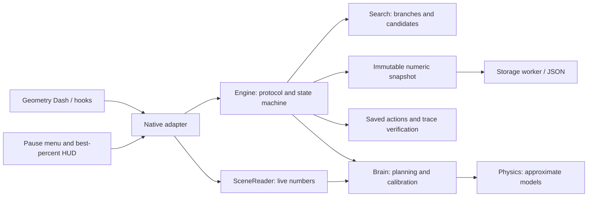

# Поток управления 2.0

| Модуль | Ответственность | Чего внутри нет |
|---|---|---|
| `types` | Типы действий/шагов/трассы, строгий формат JSON, проверка последовательности | Geode и поиск |
| `engine` | Состояния Idle/Recording/Searching/Verifying/Replaying, тики, ввод, лимиты, отложенные события | Методы игровых объектов, файловый ввод-вывод |
| `search` | Архив до 12 веток, локальные правки, распределение попыток, проверяемые префиксы | Игровой мир и сертификация успеха прогнозом |
| `brain` | Один вход в контроллер, калибровка, короткие планы, shared/independent dual | UI и сохранения |
| `physics` | Перенесённые числовые модели и структурный граф | Указатели на объекты GD и управление попытками |
| `scene` | Снимок живой геометрии/взаимодействий и порционный снимок для Analyze | Исполнение ввода |
| `native` | Реальные API GD, штатный полный reset, часы 240 Hz, перевод native кнопок | Алгоритм выбора веток |
| `storage` | Один файловый работник, coalescing снимков, atomic rename/backup | Любые вызовы GD |
| `ui` | Кнопки только в паузе; HUD содержит один процент | Собственная логика поиска |

Запись, поиск и воспроизведение используют один `Engine::tick`. У воспроизведения нет доступа к новому решению планировщика: исполняются действия файла, проверяются dt/half/last и трасса. Тестовый `SceneProvider` падает, если запись/повтор внезапно вызывают планирование.

Смерть/завершение — события. Обработка архива, файловые снимки и запрос следующего reset происходят после выхода из исходного обновления GD. Успешное native завершение пропускается только после отдельного полного проверочного повтора.

Внутренняя оценка ветки не равна рекорду. Ветка имеет счётчики uses/stalls и локальный курсор правок. Результат фактической попытки относится к явно выбранному parent; при застое другие ветки получают попытки, даже если их процент меньше. Рекорд хранится отдельно в Engine и сохранённом счётчике уровня.

Новая архитектура не заменяет приблизительные модели настоящим симулятором всех триггеров. Финальным судьёй остаётся сама игра.
